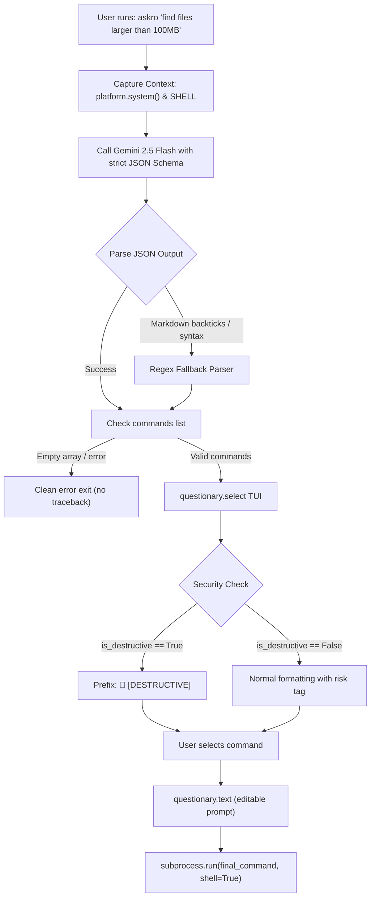

# Implementation Plan - AskRo CLI Utility

AskRo is a lightweight CLI utility that translates natural language queries into executable shell commands using the Gemini API (`gemini-2.5-flash`), with an interactive Terminal User Interface (TUI) powered by `questionary` for selecting, reviewing risk levels, editing, and executing commands natively.

## User Review Required

> [!IMPORTANT]
> **Authentication with Google GenAI SDK:**
> The `google-genai` Python SDK authenticates using the `GEMINI_API_KEY` (or `GOOGLE_API_KEY`) environment variable. While your Google account is configured in the environment, the Gemini Developer API requires an API key generated from [Google AI Studio](https://aistudio.google.com/app/apikey) (which is free and created with your Google/Gmail account in one click).
> 
> AskRo will be implemented to:
> 1. Automatically check `GEMINI_API_KEY` or `GOOGLE_API_KEY`.
> 2. Support loading from `~/.askro.env` or local `.env` if desired.
> 3. Provide a clear, colorized, user-friendly prompt if the key is not detected, explaining how to set it in `~/.zshrc` or `~/.bashrc` without crashing or printing a Python traceback.

## Proposed Architecture & Workflow



## Proposed Changes

### Core CLI Tool

#### [NEW] [askro.py](file:///Users/rohan/Documents/Workspace/AskRo/askro.py)
- **Context Collection:** Silently gathers `platform.system()` (e.g. Darwin/macOS) and `os.environ.get("SHELL")`, plus current working directory for accurate context.
- **Gemini Client & Prompting:**
  - Uses `from google import genai` with model `gemini-2.5-flash`.
  - Configures `types.GenerateContentConfig` with `response_mime_type="application/json"` and Pydantic schema enforcing:
    ```json
    {
      "commands": [
        {
          "command": "string",
          "description": "string",
          "risk_level": "LOW | MEDIUM | HIGH",
          "is_destructive": true/false
        }
      ]
    }
    ```
- **Robust JSON Parsing & Fallback:**
  - Employs regex extraction `r"```(?:json)?\s*([\s\S]*?)\s*```"` and bracket boundaries in case LLM adds backticks or surrounding text.
  - Gracefully handles empty arrays with friendly output: `"ℹ️ No executable commands found for your query. Try rephrasing."`
- **Interactive TUI via `questionary`:**
  - Choices list tagged with `🚨 [DESTRUCTIVE]` when `is_destructive` is `True`, plus `[LOW]`, `[MEDIUM]`, or `[HIGH]` risk level.
  - Includes a `[Cancel / Exit]` option and handles `Ctrl+C` / escape without tracebacks.
  - Selected command is fed into `questionary.text(..., default=selected)` for inline editing.
- **Native Execution:**
  - Executes via `subprocess.run(final_command, shell=True)` and streams output directly to stdout/stderr.

#### [NEW] [requirements.txt](file:///Users/rohan/Documents/Workspace/AskRo/requirements.txt)
- Pins `google-genai>=2.0.0` and `questionary>=2.1.0`.

#### [NEW] [setup.sh](file:///Users/rohan/Documents/Workspace/AskRo/setup.sh)
- Executable helper script to create Python virtual environment (`.venv`), install dependencies, set execute permissions (`chmod +x askro.py`), and print exact alias configuration commands.

#### [NEW] [README.md](file:///Users/rohan/Documents/Workspace/AskRo/README.md)
- Complete documentation detailing installation, API key setup, alias addition to `~/.zshrc` / `~/.bashrc`, and usage examples.

## Verification Plan

### Automated / Programmatic Tests
1. **JSON Parsing & Regex Fallback Test:** Run a test script against variations of responses (pure JSON, markdown backtick wrapped JSON, and empty arrays).
2. **Schema Validation:** Verify Pydantic schema validation for expected fields (`command`, `description`, `risk_level`, `is_destructive`).
3. **CLI Argument & Prompt Fallback:** Verify that passing arguments (e.g. `askro "list files"`) and running with no arguments both function as expected.
4. **Error Handling Test:** Verify behavior when API key is missing or invalid, ensuring clean exit code and message without stack trace.

### Manual Verification
1. Run `python3 askro.py --help` to verify CLI help message.
2. Run an end-to-end command generation and verify `questionary.select` navigation, destructive warning badge `🚨 [DESTRUCTIVE]`, editable prompt in `questionary.text`, and subprocess execution.
